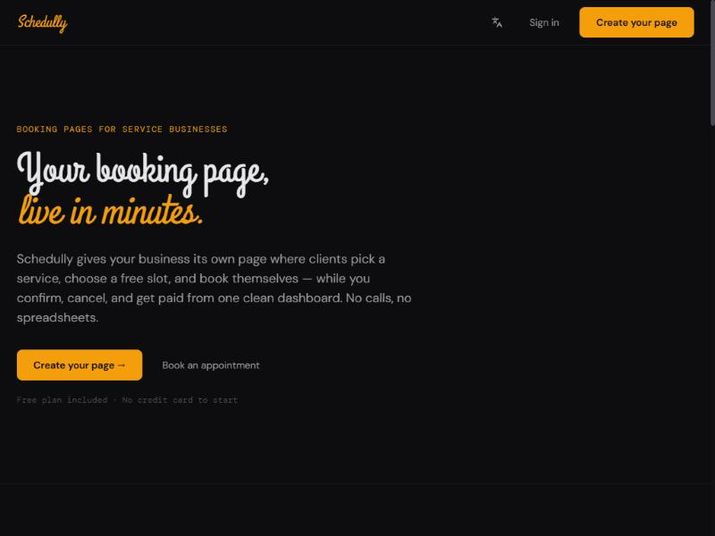
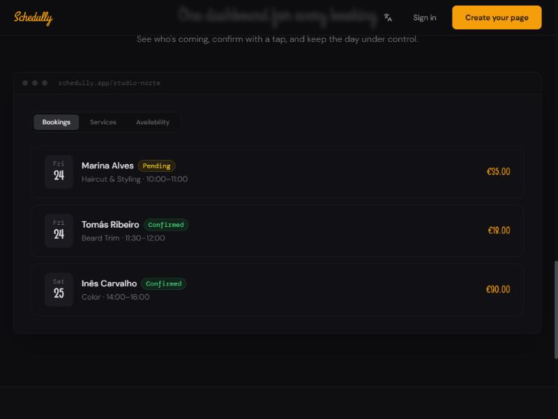

# Schedully

> Multi-tenant scheduling for service businesses — every business gets its own booking page, calendar, and dashboard.

Clients pick a service, choose a free slot, and book themselves. Owners confirm, cancel, and get paid from one clean dashboard. Built as a full-stack portfolio project: multi-tenant data model, role-based access, a slot-generation engine, Stripe billing, transactional email, and a localized UI in five languages.

**Live demo:** _set your deployed URL here_ · **Backend repo:** [schedully-back](https://github.com/SantanderNycz/schedully-back)





---

## Highlights

- **True multi-tenant** — each business has its own public page (`/book/:slug`), services, availability, and bookings, fully isolated.
- **Role-based access** — owners and clients are separate roles with distinct dashboards and server-side guards.
- **Slot engine** — available time slots are generated from weekly availability and service duration, with overlap checks so nothing is double-booked.
- **Stripe billing** — Pro subscriptions via Stripe Checkout, the billing portal, and webhook-driven plan sync.
- **Transactional email** — booking confirmations and status updates through Resend.
- **i18n** — English, Português (PT & BR), Español, Français, and 中文, with a persisted language switcher.
- **Polished UX** — public landing page, code-split routes with a Suspense loader, skeleton loading states, empty-state CTAs, a 404 page, an error boundary, and full `prefers-reduced-motion` support.

---

## Stack

| Layer    | Tech                                        |
| -------- | ------------------------------------------- |
| Frontend | React 18 + Vite + TypeScript + Tailwind CSS |
| Routing  | React Router (lazy + Suspense)              |
| State    | Zustand                                     |
| Forms    | React Hook Form + Zod                       |
| Backend  | Node + Express + TypeScript                 |
| ORM      | Drizzle ORM                                 |
| Database | PostgreSQL (Neon)                           |
| Auth     | JWT + bcryptjs                              |
| Payments | Stripe                                      |
| Email    | Resend                                      |
| Deploy   | Render (API) + Vercel (web)                 |

---

## Run locally

This repo is the **frontend**. The API lives in [schedully-back](https://github.com/SantanderNycz/schedully-back).

```bash
# 1. Install
npm install

# 2. (optional) point at a non-proxied API
#    By default, dev proxies /api -> http://localhost:3001 (see vite.config.ts)
echo "VITE_API_URL=http://localhost:3001" > .env.local

# 3. Start the dev server
npm run dev
```

Web: http://localhost:5173 · API (when running the backend): http://localhost:3001

---

## Project structure

```
src/
├── components/
│   ├── ProtectedRoute.tsx     # auth guard for /dashboard
│   ├── PublicOnlyRoute.tsx    # sends signed-in users away from / and /login
│   ├── LanguageSwitcher.tsx   # shared language dropdown
│   ├── Reveal.tsx             # scroll-reveal, reduced-motion aware
│   ├── Skeleton.tsx           # loading skeletons
│   ├── ErrorBoundary.tsx
│   ├── RouteLoader.tsx        # Suspense fallback
│   └── dashboard/             # Bookings, Services, Availability, Billing, ClientBookings
├── contexts/
│   └── LanguageContext.tsx    # translations + persisted language
├── hooks/
│   └── useAuthStore.ts        # Zustand auth store
├── lib/
│   └── api.ts                 # Axios instance + interceptors
└── pages/
    ├── LandingPage.tsx        # public marketing page
    ├── LoginPage.tsx
    ├── RegisterOwnerPage.tsx
    ├── RegisterClientPage.tsx
    ├── BookingPage.tsx        # public /book/:slug flow
    ├── DashboardPage.tsx
    └── NotFoundPage.tsx
```

---

## Routes

| Path               | Access        | Description                              |
| ------------------ | ------------- | ---------------------------------------- |
| `/`                | public        | Landing page (signed-in → `/dashboard`)  |
| `/login`           | public        | Sign in (signed-in → `/dashboard`)       |
| `/register/owner`  | public        | Create a business account                |
| `/register/client` | public        | Create a client account                  |
| `/book/:slug`      | public        | A business's booking flow                |
| `/dashboard`       | authenticated | Owner / client dashboard                 |
| `*`                | public        | 404                                      |

---

## Deploy

Frontend deploys to **Vercel**; set `VITE_API_URL` to the deployed API origin. The backend deploys to **Render** — see the [backend repo](https://github.com/SantanderNycz/schedully-back) for its environment variables and Stripe webhook setup.
